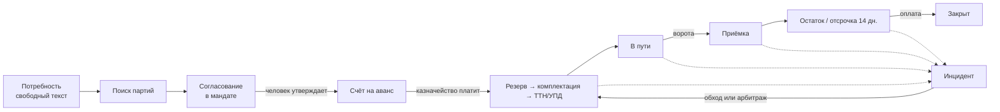
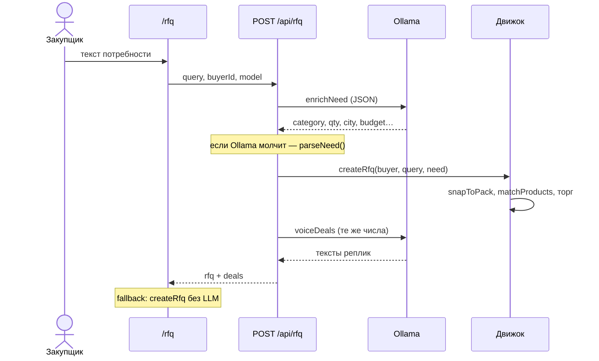
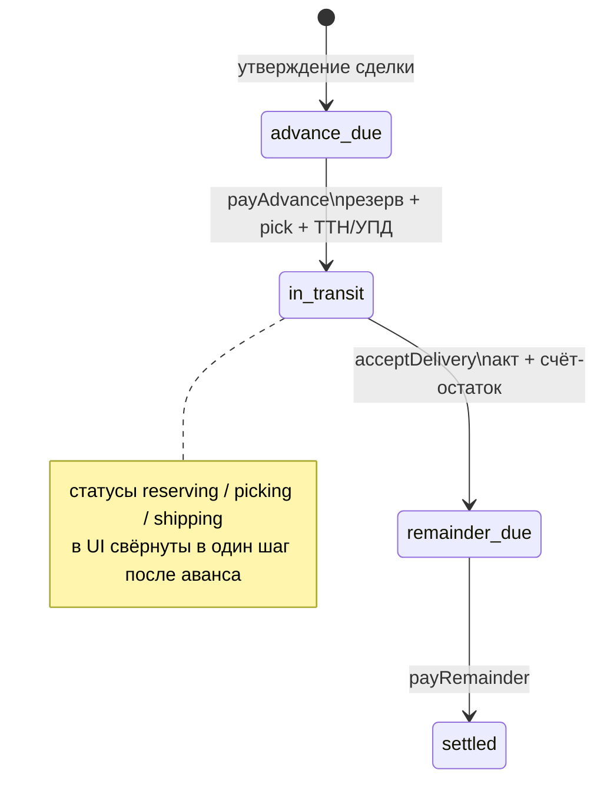
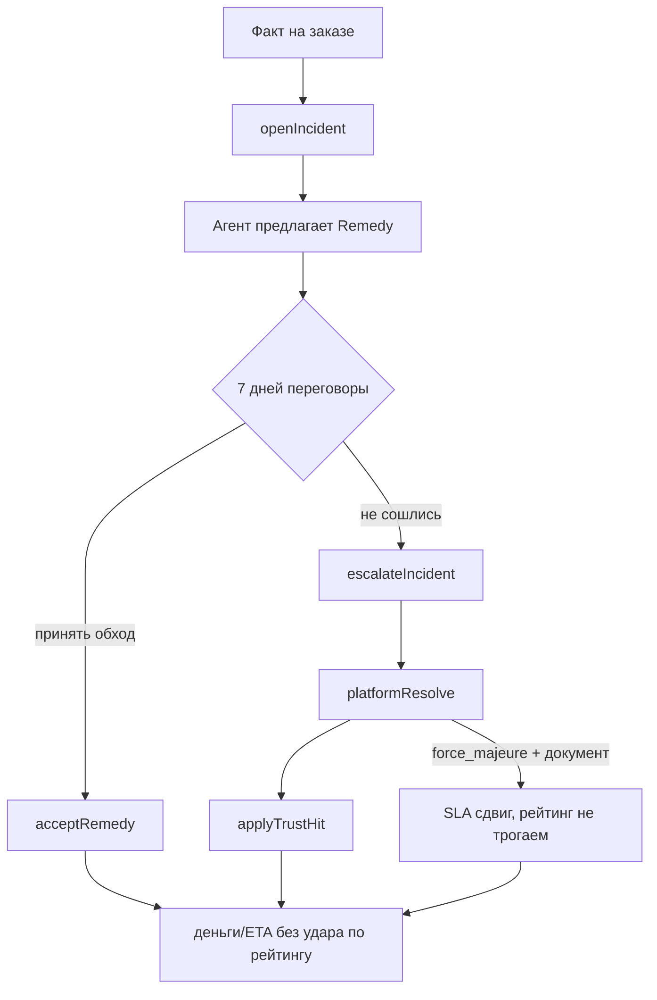

# Atrium — бизнес-процессы (как реализовано)

Прототип B2B-площадки: компании торгуют **партиями**, агенты ведут поиск и торг **в пределах мандата**, люди утверждают **деньги и товар**. Локальный Ollama пишет реплики; **цены, кратность, резерв лотов, SLA и рейтинг считает движок**.

Состояние живёт в браузере (`localStorage`, ключ `atrium-marketplace-v3`). Это демо-контур, не платёжный шлюз.

## Роли

| Роль | Кто в коде | Что делает |
|---|---|---|
| Закупщик (человек) | `currentCompanyId`, кабинет | RFQ, утверждение сделки, аванс, приёмка, остаток, претензия |
| Поставщик (человек) | переключатель компании | отказ/утверждение с своей стороны в комнате, инциденты по оплате |
| Агент закупки | `Company.agent` | парсит потребность, контрит цену и предоплату |
| Агент поставки | `Company.agent` | оффер от партий, пол маржи, FCA/DAP |
| Движок мандата | `src/lib/agents.ts`, `packing.ts`, `inventory.ts` | матч, snap к паллете/связке, пол цены, резерв |
| Ollama | `src/lib/llm-agents.ts` | JSON-парс заявки + перепись реплик **без смены чисел** |
| Площадка | `src/lib/ops.ts`, `trust.ts` | арбитраж инцидента, удар по on-time |

Человек не торгуется в чате. Он ставит мандат и нажимает шлюзы: **утвердить / оплатить / принять / эскалировать**.

---

## 1. Макроконтур

Шесть шагов на главной (`/`) совпадают с этим контуром. Седьмой слой — срыв: он не ломает пайплайн, а вешается на заказ.

---

## 2. RFQ: от фразы до комнаты сделки

**Вход:** `/rfq`, только компания с ролью buyer. Пустое поле подставляет демо-заявку на 50 000 крафт-коробок.

### 2.1 Разбор потребности

1. Правила: `src/lib/parse-need.ts` — город, категория, qty, бюджет, срок.
2. LLM: `enrichNeed` дополняет поля, **не затирает** уже найденные числа.

### 2.2 Матч партий

`matchProducts` (`src/lib/agents.ts`):

- категория и ключевые слова;
- свободный остаток лотов (`freeQty`);
- кратность упаковки;
- каталожный рейтинг;
- **on-time отгрузка продавца** (`trustOf`): ≥95% — плюс к скору, &lt;90% — риск срыва.

Объём заявки **округляется вверх** к кратности: паллета 500 шт, связка арматуры 2 т, бочка 200 кг и т.д. (`src/lib/packing.ts`).

### 2.3 Торг внутри мандата

Движок строит офферы, не LLM:

- ask / floor (маржа агента + объём);
- предоплата: если on-time **оплаты** покупателя &lt; 85% — открытие **60%** (Волга Ритейл в сиде);
- FCA, если город склада = город поставки, иначе DAP;
- статусы сделки: `countering` → `agreed` | `rejected`.

Человек в `/deals/[id]`: **утвердить** или **отклонить**. Утверждение создаёт заказ.

---

## 3. Исполнение заказа

После `approveDeal` → `createOrderFromDeal`:

- резерв лотов FIFO по готовности, кратно `packSize` (`allocateLots`);
- два счета: аванс (issued) и остаток (draft, «по приёмке / 14 дн.»);
- статус `advance_due`. **Склад не едет, пока нет оплаты аванса.**

Человеческие шлюзы (только сторона заказа):

| Действие | Условие | Эффект |
|---|---|---|
| Оплатить аванс | `advance_due` | лоты reserved, ТТН, УПД, паспорт, `in_transit` |
| Подписать приёмку | `in_transit` / `acceptance_due` | акт, остаток issued |
| Оплатить остаток | `remainder_due` | `settled` |

Пайплайн на экране: согласование → предоплата → резерв → комплектация → отгрузка → в пути → приёмка → расчёт (`ORDER_STAGES` в `src/lib/fulfillment.ts`).

Документы в контуре: спецификация, счёт, паспорт партии, ТТН, УПД, акт.

---

## 4. Инциденты и двустороннее доверие

Звёзды каталога — витрина. Рабочий балл — `TrustScore`: on-time отгрузка, on-time оплата, claim rate, время ответа, abnormal fulfillment (`src/lib/trust.ts`).

| Kind | Кто обычно открывает | Обход |
|---|---|---|
| `delay_ship` | закупщик / система | кредит %/день в остаток (как Trade Assurance) |
| `delay_pay` | поставщик | пеня + выше аванс дальше |
| `shortage` | закупщик | кредит-нота + довоз |
| `quality` | закупщик | замена лота или уценка |
| `docs` | закупщик | перевыпуск УПД/ТТН |
| `stock_miss` | закупщик | дробная отгрузка / слот |
| `force_majeure` | поставщик | сдвиг SLA без рейтинга |

Демо: заказ `ord-rebar-ural` (ТехСтрой × УралСталь) уже в `in_transit` с инцидентом «+2 дня» и кредитом 1% (6 144 ₽). Чтобы нажать обход, переключите компанию на **ТехСтрой** или **УралСталь**.

Рейтинг меняется **только** после решения площадки, не в момент алерта.

---

## 5. Что сознательно не в контуре

- Нет эквайринга и ЭДО с ФНС — счета и УПД имитируются.
- Нет мультилота «довоз второй фурой» как отдельного шипмента: `split_ship` пока текст обхода.
- LLM не двигает цену, qty, статус. Если voicing вернул другой `texts.length` — остаются шаблонные реплики.
- Матч RFQ смотрит `seedTrust`, а не live `reputations` после арбитража (ограничение прототипа).

---

## Карта кода

| Процесс | Модули | Экраны |
|---|---|---|
| RFQ + торг | `parse-need.ts`, `agents.ts`, `llm-agents.ts`, `api/rfq` | `/rfq`, `/deals` |
| Партии | `packing.ts`, `inventory.ts` | `/catalog` |
| Исполнение | `fulfillment.ts` | `/orders` |
| Инциденты | `ops.ts`, `trust.ts` | заказ, `/trust` |
| Состояние | `store.tsx` | все клиентские страницы |
