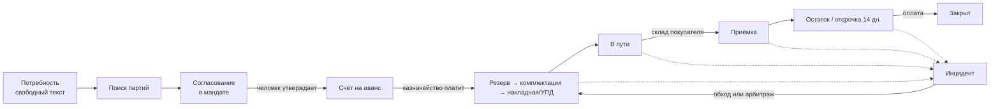
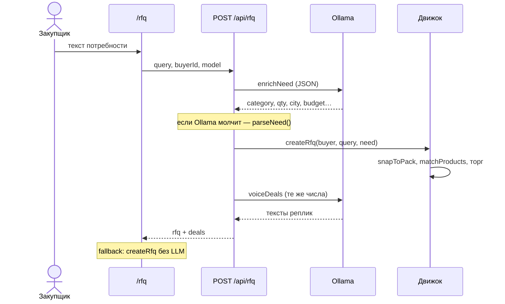
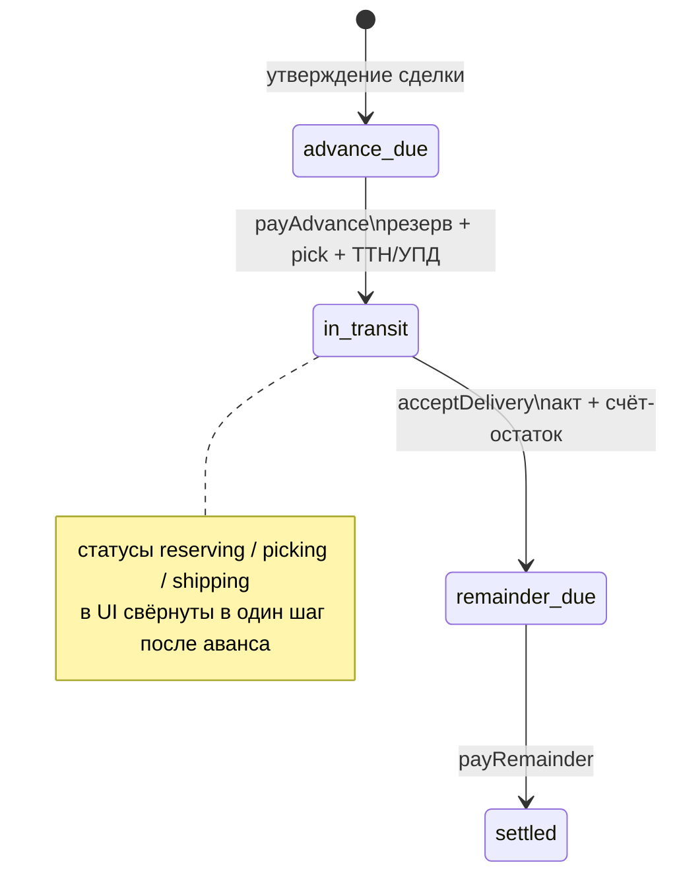

# Atrium — бизнес-процессы (как реализовано)

Прототип B2B-площадки как среды координации агентов. Концепция, архитектура слоёв и протокол действий: [CONCEPT.md](CONCEPT.md). Условия для участников (политика, досье, комплект, допуск, колокольчик): [GUIDE.md](GUIDE.md#протоколы-взаимодействия). Компании торгуют **партиями**, агенты ведут поиск и торг **в пределах мандата**, люди утверждают **деньги и товар**. Локальный Ollama пишет реплики; **цены, кратность, резерв партий, сроки и рейтинг считает движок**.

Состояние живёт в браузере (`localStorage`, ключ `atrium-marketplace-v5`). Это демо-контур, не платёжная система. Вход: [`/login`](http://127.0.0.1:3000/login), карточки с паролями.

## Роли

| Роль | Кто в коде | Что делает |
|---|---|---|
| Закупщик (человек) | логин кабинета `buy`, `currentCompanyId` | мандат, заявка, утверждение, аванс, приёмка, остаток, факт претензии |
| Поставщик (человек) | логин кабинета `sell` | выгрузка партий, утверждение с своей стороны, просрочка оплаты, форс-мажор |
| Агент закупки | `Company.agent` | разбирает потребность, отвечает встречной ценой и предоплатой |
| Агент поставки | `Company.agent` | предложение от партий, пол маржи; на претензии — обход, если поставщик ответственная сторона |
| Движок мандата | `src/lib/agents.ts`, `packing.ts`, `inventory.ts` | подбор, округление к паллете/связке, пол цены, резерв |
| Ollama | `src/lib/llm-agents.ts` | разбор заявки + перепись реплик **без смены чисел** |
| Площадка | `src/lib/ops.ts`, `incident-desk.ts`, `trust.ts` | комната претензии, обход или расторжение после аванса, удар по рейтингу |

Человек не торгуется в чате. По умолчанию агент торгует, человек входит на критическом; ужесточить или ослабить можно в кабинете. Деньги и товар подписывает сам. Колокольчик зовёт, когда допуск не сработал или открыт спор.

---

## 1. Макроконтур



Шесть шагов на главной (`/`) совпадают с этим контуром. Седьмой слой — срыв: он не ломает цепочку, а вешается на заказ.

---

## 2. Заявка: от фразы до комнаты сделки

**Вход:** `/rfq`, только компания с ролью buyer. Пустое поле подставляет демо-заявку на 50 000 крафт-коробок.



### 2.1 Разбор потребности

1. Правила: `src/lib/parse-need.ts` — город, категория, qty, бюджет, срок.
2. LLM: `enrichNeed` дополняет поля, **не затирает** уже найденные числа.

### 2.2 Матч партий

`matchProducts` (`src/lib/agents.ts`):

- категория и ключевые слова;
- свободный остаток лотов (`freeQty`);
- кратность упаковки;
- каталожный рейтинг;
- **отгрузки продавца в срок** (`trustOf`): ≥95% — плюс к скору, &lt;90% — риск срыва.

Объём заявки **округляется вверх** к кратности: паллета 500 шт, связка арматуры 2 т, бочка 200 кг и т.д. (`src/lib/packing.ts`).

### 2.3 Торг внутри мандата

Движок строит предложения, не языковая модель:

- ask / floor (маржа агента + объём);
- предоплата: если **оплаты** покупателя в срок &lt; 85% — открытие **60%** (Волга Ритейл в сиде);
- самовывоз, если город склада = город поставки, иначе доставка до покупателя;
- статусы сделки: `countering` → `agreed` | `rejected`.

Человек в `/deals/[id]`: **утвердить** или **отклонить**. Утверждение создаёт заказ.

---

## 3. Исполнение заказа

После `approveDeal` → `createOrderFromDeal`:

- резерв партий по готовности, кратно `packSize` (`allocateLots`);
- два счета: аванс (issued) и остаток (draft, «по приёмке / 14 дн.»);
- статус `advance_due`. **Склад не едет, пока нет оплаты аванса.**



Подтверждения человека (только сторона заказа):

| Действие | Условие | Эффект |
|---|---|---|
| Оплатить аванс | `advance_due` | партии в резерве, накладная, УПД, паспорт, `in_transit` |
| Подписать приёмку | `in_transit` / `acceptance_due` | акт, остаток issued |
| Оплатить остаток | `remainder_due` | `settled` |

Пайплайн на экране: согласование → предоплата → резерв → комплектация → отгрузка → в пути → приёмка → расчёт (`ORDER_STAGES` в `src/lib/fulfillment.ts`).

Документы в контуре: спецификация, счёт, паспорт партии, накладная, УПД, акт.

---

## 4. Инциденты и двустороннее доверие

Схема для чтения: [`GUIDE.md` § 6](GUIDE.md#6-схема-разрешения-инцидентов). Здесь — как это сделано в коде.

Звёзды каталога — витрина. Рабочий балл — `TrustScore`: отгрузки в срок, оплаты в срок, доля претензий, время ответа, доля срывов (`src/lib/trust.ts`). Роли шага: `src/lib/incident-desk.ts`. Комната: `/orders/[id]/incident`.

```
человек заявителя → факт
        ↓
агент ответственной стороны → Remedy (сразу, рейтинг не трогаем)
        ↓
человек заявителя → принять   → applyContinue по кейсу, заказ живой, рейтинг нет
                 → отклонить → бэкофис:
                                 platformResolve  → тот же обход + applyTrustHit
                                 platformUnwind   → если плейбук кейса даёт откат:
                                                     unpaid: releaseLots, cancelled
                                                     paid: аванс к возврату, releaseLots, cancelled
                                 force_majeure: рейтинг нет в обоих ветках
```

На закрытом контуре (`settled` / `cancelled`) новые факты не открывают. Виды факта зависят от статуса заказа, не вываливаются все сразу.

Плейбук кейса — `src/lib/incident-playbook.ts`. На карточке факта видно обход и откат, если он есть. Кнопки в комнате применяют эти эффекты, а не общий текст.

| Kind | Обход | Откат |
|---|---|---|
| `delay_ship` | зачёт в остаток, ETA+ | после аванса: возврат денег |
| `delay_pay` | пеня в остаток | только `advance_due`: снять резерв |
| `shortage` | акт, зачёт, довоз | возврат груза |
| `quality` | замена / −8% | возврат партии |
| `docs` | перевыпуск УПД/ТТН | отказ в приёмке |
| `stock_miss` | дроблёная отгрузка | до аванса резерв; после — деньги |
| `force_majeure` | срок+, рейтинг нет | откат без рейтинга |

Демо: заказ `ord-rebar-ural` (ТехСтрой × УралСталь) уже в `in_transit` с инцидентом «+2 дня» и кредитом 1% (6 144 ₽). Вход: закупщик **1112**, комната `/orders/ord-rebar-ural/incident`. Обход принимает человек ТехСтроя. Площадка (`0000`) входит только после «Отклонить → площадка».

Рейтинг меняется **только** после решения площадки, не в момент факта и не в момент предложения обхода. Откат до аванса рейтинг не трогает: денег в контуре не было.

---

## 5. Что сознательно не в контуре

- Нет эквайринга и ЭДО с ФНС — счета и УПД имитируются.
- Довоз второй фурой — запись `shipment` со статусом `planned`, не отдельный заказ.
- LLM не двигает цену, qty, статус. Если voicing вернул другой `texts.length` — остаются шаблонные реплики.
- Подбор заявок смотрит живые `reputations` после арбитража (передаются в движок вместе с заявкой).

---

## Карта кода

| Процесс | Модули | Экраны |
|---|---|---|
| Заявка + торг | `parse-need.ts`, `agents.ts`, `llm-agents.ts`, `api/rfq` | `/rfq`, `/deals`, `/demo` |
| Партии | `packing.ts`, `inventory.ts` | `/catalog` |
| Исполнение | `fulfillment.ts` | `/orders` |
| Инциденты | `incident-playbook.ts`, `ops.ts`, `trust.ts` | `/orders/{id}/incident`, `/office` |
| Сценарии и оценка | `scenarios.ts`, `effectiveness.ts` | `/concept`, `/trust` |
| Состояние | `store.tsx` | все клиентские страницы |
