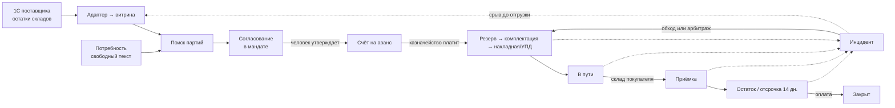
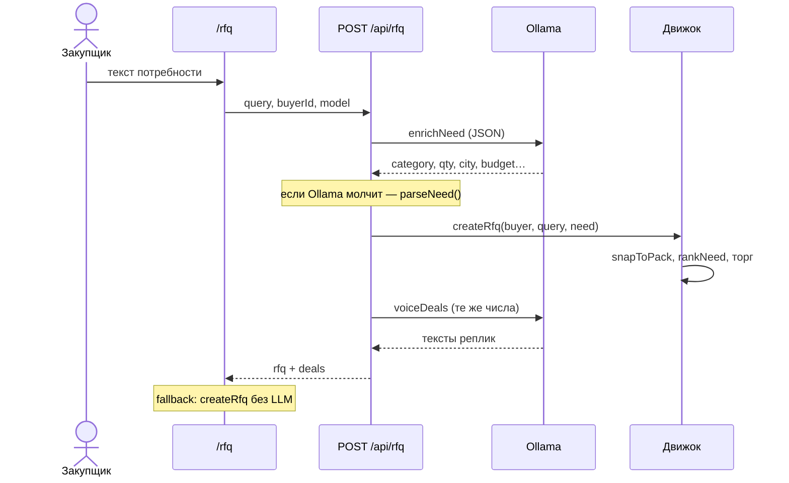
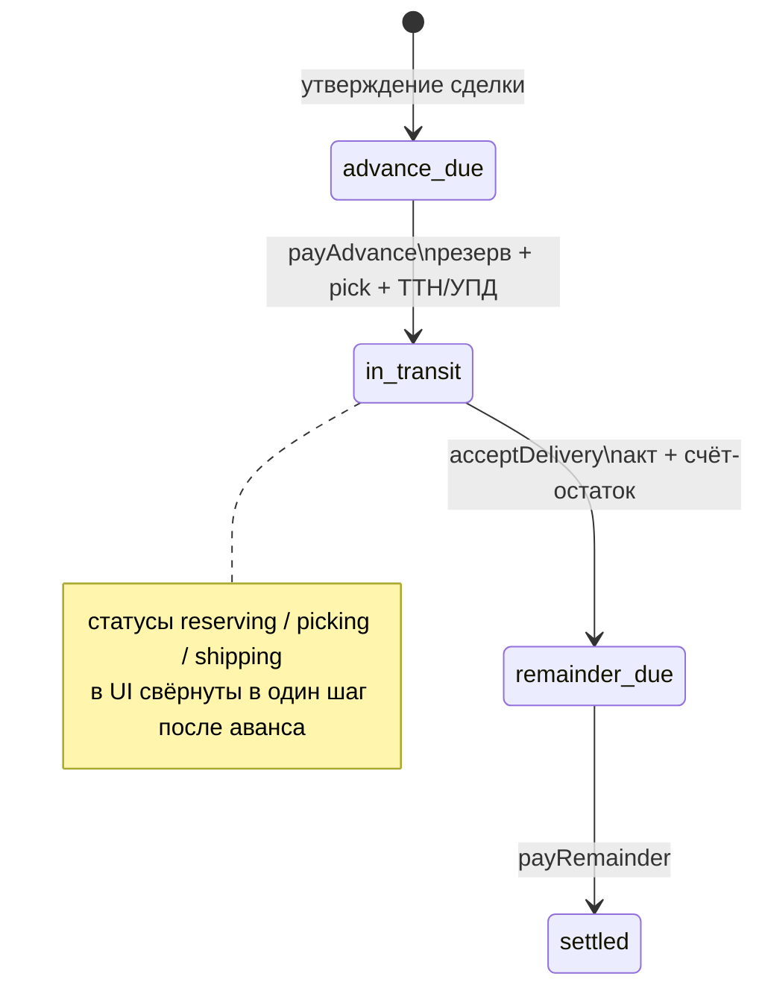
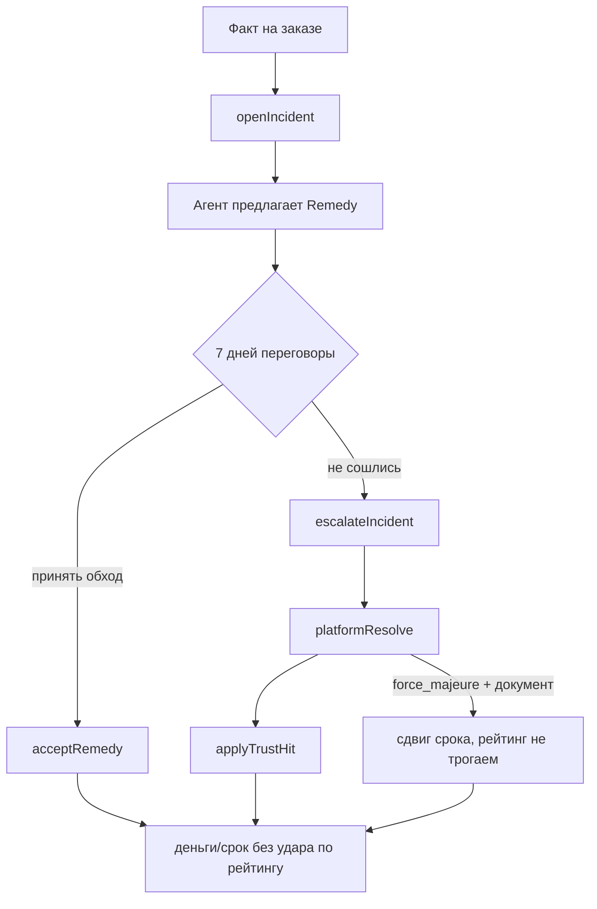

# Atrium — бизнес-процессы (как реализовано)

Прототип B2B-площадки как среды координации агентов. Концепция, архитектура слоёв и протокол действий: [CONCEPT.md](CONCEPT.md). Компании торгуют **партиями**, агенты ведут поиск и торг **в пределах мандата**, люди утверждают **деньги и товар**. Локальный Ollama пишет реплики; **цены, кратность, резерв партий, сроки и рейтинг считает движок**.

Состояние живёт в браузере (`localStorage`, ключ `atrium-marketplace-v4`). Это демо-контур, не платёжная система.

## Роли

| Роль | Кто в коде | Что делает |
|---|---|---|
| Закупщик (человек) | `currentCompanyId`, кабинет | заявка, утверждение сделки, аванс, приёмка, остаток, претензия |
| Поставщик (человек) | переключатель компании | отказ/утверждение с своей стороны в комнате, инциденты по оплате |
| Агент закупки | `Company.agent` | разбирает потребность, отвечает встречной ценой и предоплатой |
| Агент поставки | `Company.agent` | предложение от партий, пол маржи, самовывоз или доставка |
| Движок мандата | `src/lib/agents.ts`, `packing.ts`, `inventory.ts` | подбор, округление к паллете/связке, пол цены, резерв |
| Ollama | `src/lib/llm-agents.ts` | разбор заявки + перепись реплик **без смены чисел** |
| Площадка | `src/lib/ops.ts`, `trust.ts` | арбитраж инцидента, удар по доле поставок в срок |

Человек не торгуется в чате. Он ставит мандат и подтверждает: **утвердить / оплатить / принять / эскалировать**.

---

## 1. Макроконтур

Шаг 00 — загрузка партий (`/sell/adapter`). Поиск смотрит живой `freeQty`, не прайс. Схема на `/process` и на главной. Срыв не ломает цепочку: обход или возврат лотов на витрину.

---

## 1.1 Витрина: загрузка товаров (S0)

**Вход:** кабинет поставщика `/sell/adapter`. Пример выгрузки «ОстаткиСкладов», не коннектор 1С.

1. CSV: артикул, остаток, кратность, мин. цена, склад, партия, сертификат.
2. Адаптер (`src/lib/lot-adapter.ts`) собирает **все** нарушения строки сразу, не первое: услуга, нет пола, нулевой остаток, нет SKU, не кратно паллете. У каждой причины — факт, что чинить, кто (поставщик или человек площадки).
3. Экран «принять / отсев» — страховка, как подтверждение полки у закупки. Витрина, резерв и рейтинг **не меняются**, пока поставщик не нажмёт «Выложить».
4. Кнопка пишет только лоты с этой выгрузки. Повторный импорт не сносит чужие партии и не обнуляет уже взятый резерв. Активную организацию адаптер не подменяет.

Человек поставщика подтверждает выгрузку. Площадка не подставляет чужие остатки.

**Пример.** Демо-CSV на `/sell/adapter` (СеверПак):

| Строка | Что на экране | Кто чинит |
|---|---|---|
| SP-300-K, SP-400-W, SP-ST20 | «принять» — пол, SKU, кратность на месте | — |
| **SP-XXX**, МинЦена пустая, артикула нет на площадке | две причины сразу: нет пола **и** нет карточки SKU | поставщик ставит МинЦену; человек площадки — онбординг |
| **Доставка фурой**, ед. «усл» | услуга + нет SKU | поставщик убирает услугу из остатков |

Без «Выложить» витрина не меняется. Повторная выгрузка не стирает чужие лоты и не обнуляет резерв.

---

## 2. Заявка: от фразы до комнаты сделки

**Вход:** `/rfq`, только компания с ролью buyer. Пустое поле подставляет демо-заявку на 50 000 крафт-коробок.

### 2.1 Разбор потребности

1. Правила: `src/lib/parse-need.ts` — город, категория, qty, бюджет, срок.
2. LLM: `enrichNeed` дополняет поля, **не затирает** уже найденные числа.
3. Страховка `/rfq`: человек видит полку и **потолок заявки** (бюджет ÷ объём после кратности) рядом с листом витрины (`src/lib/mandate-preview.ts`). Если объём промахнулся, а ориентир остался прежним — либо «выше рынка», либо «торг не сойдётся». Пол поставщика на этом экране не показывается.

Порог «выше рынка» — **+6% к листу** карточки SKU (как мандат АгроТеха). Ниже **92% листа** — предупреждение, что мандаты скорее не пересекутся. Рынок здесь — лист витрины, не пол продавца.

**Пример.** Демо-фраза: «Ищем 12 тонн арматуры А500С Ø12, Челябинск или ближайшие, срок 10 дней, ориентир 620 тыс.» Карточка УралСтали: лист **52 800 ₽/т**, свободно около 640 т, кратность 2 т.

| Что ввёл закупщик | Потолок заявки | Что показывает страховка | Если всё же искать |
|---|---|---|---|
| 12 т, ориентир 620 тыс. | 51 667 ₽/т | спокойно: потолок рядом с листом 52 800 ₽/т | торг в мандате, комнаты открываются |
| **2 т**, тот же ориентир 620 тыс. | **310 000 ₽/т** | красное: потолок ~в 6 раз выше листа, разрешена переплата к рынку — проверьте объём или бюджет | агент всё равно сойдётся **у листа** (~53 тыс./т), лишние 620 тыс. не «защита», а дырявый потолок |
| **120 т**, тот же ориентир 620 тыс. | **5 167 ₽/т** | красное: потолок ниже листа, торг скорее не сойдётся | продавец на 120 т **есть** (остаток 640 т). Ломается не поиск, а мандат: оферта не пройдёт в потолок |

Контроль не угадывает «хотели 12». Он считает **бюджет на единицу после кратности** и сравнивает с публичным листом. Опечатка в qty при том же ориентире всегда бьёт в один из двух краёв: слишком дорого относительно рынка или слишком дёшево для согласия.

### 2.2 Матч партий

`rankNeed` / `matchProducts` (`src/lib/agents.ts`):

- категория и ключевые слова;
- свободный остаток лотов (`freeQty`);
- кратность упаковки;
- каталожный рейтинг;
- **отгрузки продавца в срок** (`trustOf`): ≥95% — плюс к скору, &lt;90% — риск срыва.

Объём заявки **округляется вверх** к кратности: паллета 500 шт, связка арматуры 2 т, бочка 200 кг и т.д. (`src/lib/packing.ts`).

Чужая полка, чужая единица или нехватка свободного qty **не открывают комнату**. На `/rfq` — карточка отказа: факт и следующий шаг (сменить полку, снизить объём, другую единицу). Ближайшие непрошедшие кандидаты пишутся в `Rfq.rejects`.

**Примеры после кнопки «искать»** (страховка уже пройдена):

| Заявка | Результат | Что дальше |
|---|---|---|
| 50 000 коробок, полку сменили на **Химию** | комнат нет; отказ: единица кг vs шт, мало свободного qty | вернуть полку «Упаковка» или сменить единицу |
| 50 000 коробок, объём **5 000 000** шт | комнат нет; отказ `no_free_qty` | снизить объём |
| 50 000 коробок, бюджет **100 тыс.** | комнаты могут открыться, торг даст отказ: потолок ниже оферты | поднять ориентир; закупщик в карточке **не видит пол** |

### 2.3 Торг внутри мандата

Движок строит предложения, не языковая модель:

- ask / floor (маржа агента + объём);
- потолок заявки **не поднимается** до пола продавца: если пол выше бюджета — отказ `floor_above_cap`, без подстановки мандата закупки;
- если продавец на жёстком крае не уступил — `seller_held`;
- предоплата: если **оплаты** покупателя в срок &lt; 85% — открытие **60%** (Волга Ритейл в сиде);
- самовывоз, если город склада = город поставки, иначе доставка до покупателя;
- статусы сделки: `countering` → `agreed` | `rejected`. У отказа в комнате — та же карточка (факт / что дальше). Закупщик в тексте отказа **не видит пол**.

Человек в `/deals/[id]`: **утвердить** или **отклонить**. Утверждение создаёт заказ.

**Пример.** Арматура УралСтали: лист 52 800 ₽/т, пол **49 104 ₽/т** (закупщик пол не видит).

| Мандат | Код | Что видит закупщик | Что делает движок |
|---|---|---|---|
| 12 т, потолок 51 667 ₽/т | согласие | цена внутри мандата (не выше потолка) | пол 49 104 ≤ потолок, комнаты живые |
| **120 т**, потолок 5 167 ₽/т | `floor_above_cap` | «оферта не проходит в потолок; мандаты не пересеклись» | потолок **не** поднимается до пола |
| 50 000 коробок, бюджет **100 тыс.** (2 ₽/шт при листе 42) | `floor_above_cap` | то же | пол скрыт; «агент не нашёл» не пишем |
| продавец на тактике «жёсткий край», отрезок пустой | `seller_held` | «поставщик не уступил» | без подстановки мандата закупки |

### 2.4 Памятка по контрагенту

Перед новой заявкой и в комнате — короткая строка из **сделок и заказов сессии** плюс `trust` (`src/lib/partner-memo.ts`), не выдумка модели. Сколько закрыли в этой сессии, доля отгрузок (закупщику) или оплат (поставщику) в срок, сколько раз понадобился человек, рекомендованный ход: ещё круг агентов / сменить тактику / звонок. Частоту схода к нижней границе мандата видит только поставщик.

**Пример.** Сид: ТехСтрой × УралСталь, заказ `ord-rebar-ural` в пути, инцидент «+2 дня».

| Кто смотрит | Что в строке | Чего нет |
|---|---|---|
| ТехСтрой (`1112`) на УралСталь | отгрузки в срок %, сколько раз понадобился человек, «сразу звонок» из‑за открытого инцидента | пол, «сходились у нижней границы» |
| УралСталь (`2223`) на ТехСтрой | оплаты в срок %, сход у пола (если сделки согласились у 49 104) | потолок закупки, чужие пары |

---

## 3. Исполнение заказа

После `approveDeal` → `createOrderFromDeal`:

- резерв партий по готовности, кратно `packSize` (`allocateLots`);
- два счета: аванс (issued) и остаток (draft, «по приёмке / 14 дн.»);
- статус `advance_due`. **Склад не едет, пока нет оплаты аванса.**

Подтверждения человека (только сторона заказа):

| Действие | Условие | Эффект |
|---|---|---|
| Оплатить аванс | `advance_due` | партии в резерве, накладная, УПД, паспорт, `in_transit` |
| Подписать приёмку | `in_transit` / `acceptance_due` | акт, остаток issued |
| Оплатить остаток | `remainder_due` | `settled` |

Пайплайн на экране: согласование → предоплата → резерв → комплектация → отгрузка → в пути → приёмка → расчёт (`ORDER_STAGES` в `src/lib/fulfillment.ts`).

Документы в контуре: спецификация, счёт, паспорт партии, накладная, УПД, акт.

---

## 4. Инциденты и двустороннее доверие

Звёзды каталога — витрина. Рабочий балл — `TrustScore`: отгрузки в срок, оплаты в срок, доля претензий, время ответа, доля срывов (`src/lib/trust.ts`).

| Kind | Кто обычно открывает | Обход |
|---|---|---|
| `delay_ship` | закупщик / система | зачёт %/день в остаток |
| `delay_pay` | поставщик | пеня + выше аванс дальше |
| `shortage` | закупщик | кредит-нота + довоз |
| `quality` | закупщик | замена лота или уценка |
| `docs` | закупщик | перевыпуск УПД/ТТН |
| `stock_miss` | закупщик | дробная отгрузка / слот |
| `force_majeure` | поставщик | сдвиг срока без рейтинга |

Демо: заказ `ord-rebar-ural` (ТехСтрой × УралСталь) уже в `in_transit` с инцидентом «+2 дня» и кредитом 1% (6 144 ₽). Чтобы нажать обход, переключите компанию на **ТехСтрой** или **УралСталь**.

## 4.1 Примеры контроля (сводка)

Один контур, разные экраны. Модель нигде не «решает скидку».

| Где | Ошибка человека | Что видит | Что не видит |
|---|---|---|---|
| `/sell/adapter` | в остатки попали услуга и строка без пола | SP-XXX: нет пола + нет SKU; доставка: услуга + нет SKU | чужие лоты, резерв |
| `/rfq` страховка | 12 т арматуры написали **2 т**, ориентир 620 тыс. | красное: потолок 310 000 ₽/т vs лист 52 800 | пол УралСтали |
| `/rfq` страховка | те же 620 тыс. на **120 т** | красное: потолок 5 167 ₽/т, торг не сойдётся | «продавца нет» — он как раз есть |
| `/rfq` после поиска | полка «Химия» на коробки | карточка отказа, не пустая комната | цена пола |
| `/deals/[id]` | мандаты не пересеклись | факт + следующий шаг | пол / маржа / потолок контрагента |
| Кабинет, заявка, комната | повторный заход к партнёру | памятка из сессии: закрытия, срок, сколько раз нужен человек | выдуманная история моделью |

Демо-вход: закупщик ТехСтрой `1112`, поставщик СеверПак `2222`. Арматура — демо-кнопка на `/rfq`. Адаптер — `/sell/adapter`.

---

## 5. Что сознательно не в контуре

- Нет эквайринга и ЭДО с ФНС — счета и УПД имитируются.
- Нет мультилота «довоз второй фурой» как отдельного шипмента: `split_ship` пока текст обхода.
- LLM не двигает цену, qty, статус. Если voicing вернул другой `texts.length` — остаются шаблонные реплики.
- Подбор заявок смотрит живые `reputations` после арбитража (передаются в движок вместе с заявкой).

---

## Карта кода

| Процесс | Модули | Экраны |
|---|---|---|
| Заявка + торг | `parse-need.ts`, `agents.ts`, `bargain.ts`, `llm-agents.ts`, `api/rfq` | `/rfq`, `/deals`, `/demo` |
| Карточка отказа | `agents.ts`, `lot-adapter.ts` | `/rfq`, `/sell/adapter`, комната |
| Памятка контрагента | `partner-memo.ts`, заказы/сделки в `store.tsx` | кабинет, `/rfq`, `/deals/[id]` |
| Витрина / 1С | `lot-adapter.ts`, `inventory.ts` | `/sell/adapter`, `/process` |
| Партии | `packing.ts`, `inventory.ts` | `/catalog` |
| Исполнение | `fulfillment.ts` | `/orders` |
| Инциденты | `ops.ts`, `trust.ts` | заказ, `/trust` |
| Сценарии и оценка | `scenarios.ts`, `agent-graph.ts`, `effectiveness.ts` | `/concept`, `/office/flow`, `/trust` |
| Состояние | `store.tsx` | все клиентские страницы |
